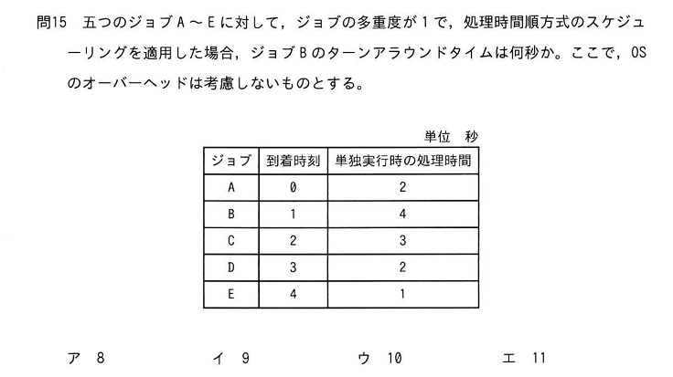
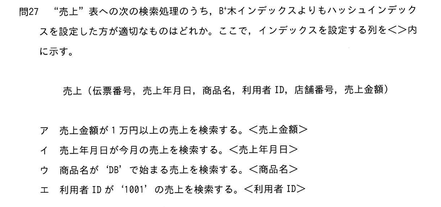
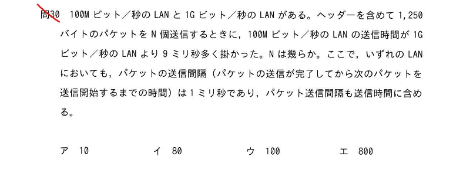
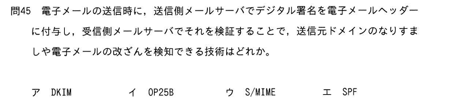
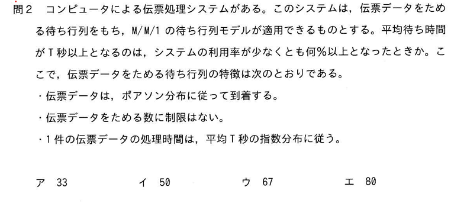

# 错题集

## 处理时间顺序方式（非抢占式 SJF）的周转时间

- **题目：** 作业 A～E 的到达时刻分别为 0、1、2、3、4 秒，处理时间分别为 2、4、3、2、1 秒。采用处理时间顺序方式（非抢占式），求作业 B 的周转时间；不考虑 OS 开销。
- **规则：** 每次 CPU 空闲时，从已经到达且等待中的作业里选择处理时间最短者；开始后运行到完成。周转时间 = 完成时刻 - 到达时刻。
- **调度：** A（0–2）→ C（2–5）→ E（5–6）→ D（6–8）→ B（8–12）。
- **答案：** B 于 1 秒到达、12 秒完成，周转时间 = 12 - 1 = **11 秒**（选项 エ）。
- **易错点：** 周转时间不是 B 的处理时间（4 秒）；每个作业完成后都要重新在“已到达的等待作业”中选择最短者。

## B+ 树索引与哈希索引的选择

- **题目：** 对“売上”表设置索引时，以下检索中，哪一种更适合使用哈希索引而不是 B+ 树索引？
  - ア：売上金額が1万円以上（销售金额不少于 1 万日元），索引列为销售金额。
  - イ：检索本月的销售记录，索引列为销售年月日。
  - ウ：商品名以“DB”开头，索引列为商品名。
  - エ：利用者 ID 为“1001”，索引列为用户 ID。
- **规则：** B+ 树索引支持大小比较、范围检索和有序检索；哈希索引擅长等值检索，一般不适合范围检索或前缀检索。
- **答案：** **エ**。用户 ID = “1001”是等值检索，适合哈希索引。
- **选项辨析：** ア 是金额范围；イ 是日期区间；ウ 是字符串前缀检索，这些都更适合 B+ 树索引。
- **易错点：** 不要只看字段类型，要看查询条件：等值匹配倾向哈希；范围、排序、前缀匹配倾向 B+ 树。

## 两种 LAN 的报文发送时间差

- **题目：** 有 100 Mbit/s 和 1 Gbit/s 两种 LAN。发送 N 个每个含头部共 1,250 字节的报文时，100 Mbit/s LAN 比 1 Gbit/s LAN 多用 9 ms。两种 LAN 上报文发送间隔（一个报文发送完成至下一个报文开始发送的时间）均为 1 ms，且该间隔包含报文发送时间。求 N。
- **计算：** 每个报文为 1,250 × 8 = 10,000 bit。100 Mbit/s 上发送耗时 10,000 ÷ 100,000,000 = 0.1 ms；1 Gbit/s 上耗时 0.01 ms。每个报文的发送耗时差为 0.09 ms。
- **求解：** 两种 LAN 的间隔相同，比较总耗时差时抵消，因此 N × 0.09 ms = 9 ms，N = **100**。
- **答案：** **ウ：100 个**。
- **易错点：** 注意字节要乘 8 转为 bit；1 ms 的发送间隔两边相同，不应误认为它也造成两种 LAN 的时间差。

## 电子邮件域名认证与改ざん检测

- **题目：** 发送邮件时，发送侧邮件服务器在邮件头中附加数字签名，接收侧邮件服务器验证该签名，以检测发信源域名伪装和邮件篡改。此技术是什么？
- **答案：** **ア：DKIM**（DomainKeys Identified Mail）。
- **原理：** 发送服务器使用域名对应的私钥生成邮件签名；接收服务器查询 DNS 中发布的公钥并验证签名。验证可确认邮件与签名域名相关，并检测签名覆盖内容是否被修改。
- **选项辨析：**
  - **OP25B**：限制向外部网络直接发送 SMTP 邮件的 TCP 25 端口，主要用于抑制垃圾邮件。
  - **S/MIME**：使用数字证书对邮件进行端到端签名或加密，不是邮件域名级的服务器认证方式。
  - **SPF**：通过 DNS 指定哪些发送服务器获准代表某域发送邮件，检查发送主机授权；不在邮件头中附加邮件内容的数字签名。
- **易错点：** DKIM 关注邮件签名及内容完整性；SPF 关注发送服务器是否被域名授权。两者都与发件人伪装防护相关，但机制不同。

## M/M/1 排队模型的平均等待时间与利用率

- **题目：** 传票数据按泊松分布到达，单个数据的处理时间服从平均值为 T 秒的指数分布，系统适用 M/M/1 模型。平均排队等待时间（不含处理时间）达到 T 秒以上时，系统利用率至少为多少？
- **公式：** 设到达率为 λ、服务率为 μ，则利用率 ρ = λ/μ，M/M/1 的平均排队等待时间 Wq = λ/[μ(μ−λ)] = ρ/[μ(1−ρ)]。
- **计算：** 平均处理时间为 T，所以 μ = 1/T。令 Wq ≥ T：
  ρ/[μ(1−ρ)] ≥ T
  代入 μ = 1/T，得到 ρ/(1−ρ) ≥ 1，因此 ρ ≥ 0.5。
- **答案：** **イ：50%**。利用率达到 50% 时，平均排队等待时间恰为 T；高于 50% 时等待时间超过 T。
- **易错点：** 题目问的是“平均待ち時間”（排队等待、不含服务时间），不是包含处理时间的平均系统逗留时间。
